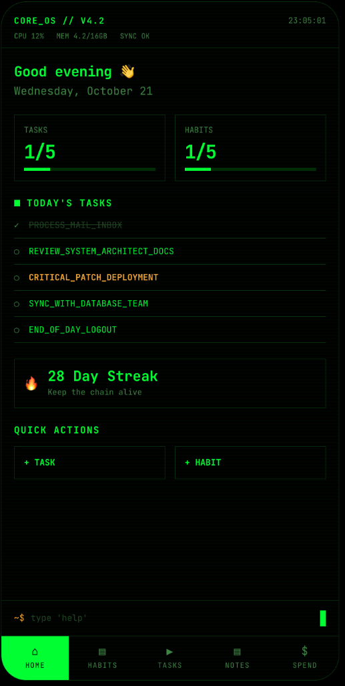
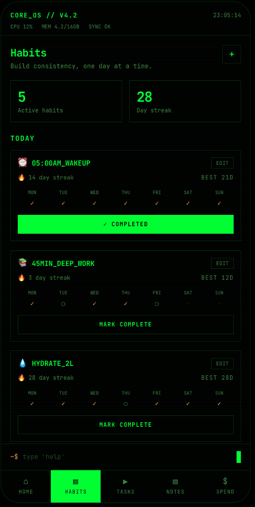
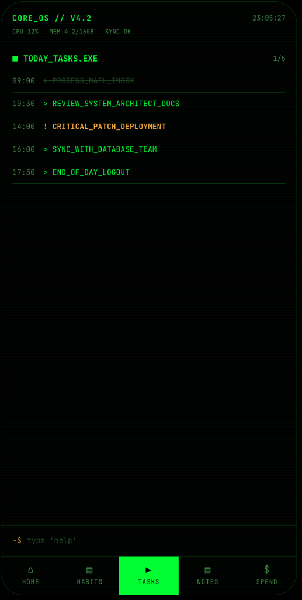
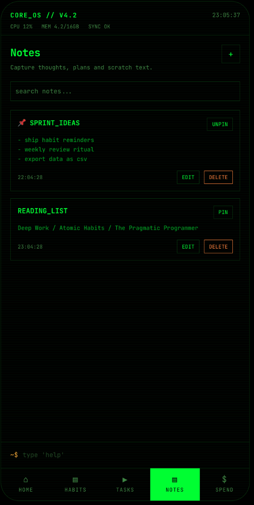
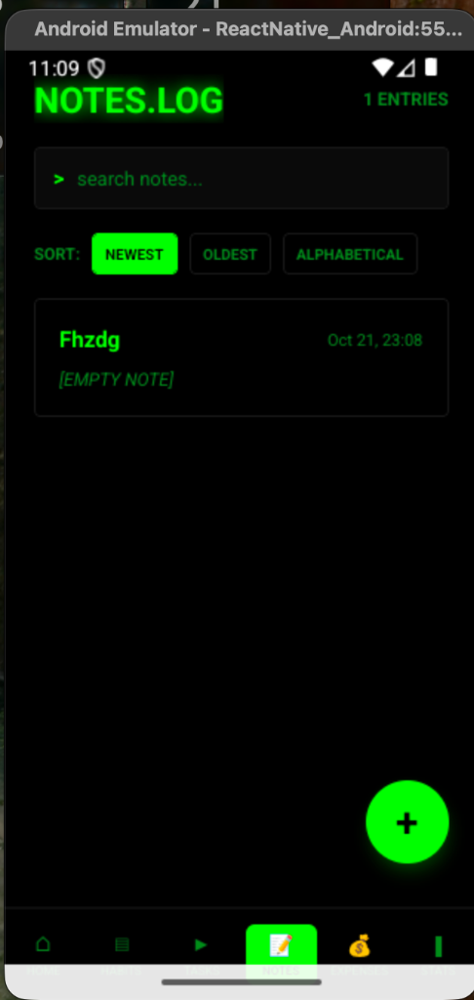
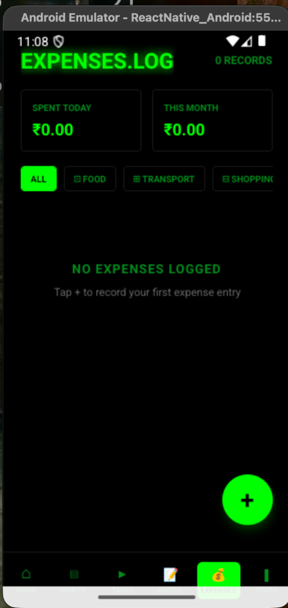
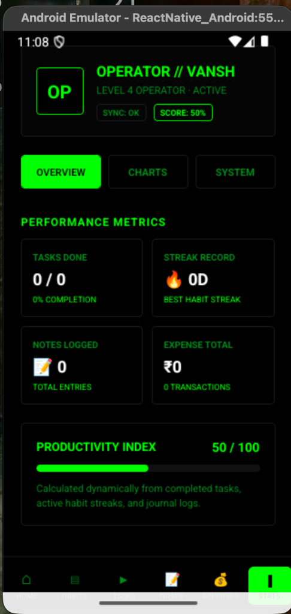

<div align="center">

```
 ██████╗  ██████╗  ██████╗██╗  ██╗███████╗████████╗ ██████╗ ██████╗ ███████╗
 ██╔══██╗██╔═══██╗██╔════╝██║ ██╔╝██╔════╝╚══██╔══╝██╔═══██╗██╔══██╗██╔════╝
 ██████╔╝██║   ██║██║     █████╔╝ █████╗     ██║   ██║   ██║██████╔╝███████╗
 ██╔═══╝ ██║   ██║██║     ██╔═██╗ ██╔══╝     ██║   ██║   ██║██╔═══╝ ╚════██║
 ██║     ╚██████╔╝╚██████╗██║  ██╗███████╗   ██║   ╚██████╔╝██║     ███████║
 ╚═╝      ╚═════╝  ╚═════╝╚═╝  ╚═╝╚══════╝   ╚═╝    ╚═════╝ ╚═╝     ╚══════╝
```

**`CORE_OS // V4.2`** — Your personal command centre. Terminal-themed productivity for the modern operator.

[](https://reactnative.dev)
[](https://www.typescriptlang.org)
[](https://redux-toolkit.js.org)
[](#)

</div>

---

## 📡 Overview

**PocketOps** is a sleek, terminal-inspired personal productivity app built with **React Native** and **TypeScript**. It combines task management, habit tracking, note-taking, and expense logging into a single unified command centre — all wrapped in a hacker-aesthetic, neon-green-on-black UI.

Think of it as your daily operating system for life — structured, minimal, and built for operators who mean business.

---

## 📸 Screenshots

<div align="center">

### Core Screens

| Home Dashboard | Habits | Tasks |
|:-:|:-:|:-:|
|  |  |  |
| Live stats dashboard with greeting, today's tasks, streak counter & quick actions | Track habits with streaks, weekly progress grid and one-tap completion | Time-stamped task list with priority markers (`!` for critical) |

### More Screens

| Notes (iOS) | Notes List | Expenses | Profile |
|:-:|:-:|:-:|:-:|
|  |  |  |  |
| Pinnable notes with search, edit and delete | `NOTES.LOG` — sortable list (Newest / Oldest / A-Z) with search | `EXPENSES.LOG` — today's & monthly spend with category filters | Operator profile with performance metrics & productivity index |

</div>

---

## ✨ Features

### 🏠 Home — Command Centre
- Live **clock** updating every second
- Personalised **time-based greeting** (Good morning / afternoon / evening)
- **Summary cards** for Tasks, Habits, Notes, and Today's Spend (INR)
- Animated **progress bars** for tasks and habits
- Today's top 5 tasks at a glance with completion state
- **Habit streak tracker** — keeps the chain alive 🔥
- Quick-action buttons: `+ TASK`, `+ HABIT`, `+ NOTE`, `+ EXPENSE`
- Terminal-style status bar: `CORE_OS // V4.2 · CPU · MEM · SYNC`

### ✅ Tasks — `TODAY_TASKS.EXE`
- Add tasks with **scheduled times** and priority levels
- Tasks displayed in chronological order with time stamps
- Mark tasks complete with real-time state updates via Redux
- Priority marker (`!`) for **critical tasks** highlighted in orange
- Persisted across sessions using AsyncStorage

### 🔥 Habits — Build Consistency
- Create habits with custom names and emoji icons
- Weekly **completion grid** (MON → SUN) per habit
- Per-habit **current streak** and **best streak** tracking
- One-tap **MARK COMPLETE** / **✓ COMPLETED** toggle
- Active habit count + global day streak at the top

### 📝 Notes — Capture Everything
- Full-text notes with timestamps
- **Pin** important notes to the top
- **Search** through notes in real time
- Edit & delete with inline controls
- Scratch-pad style — fast, frictionless, always available

### 💸 Spend — `EXPENSES.LOG`
- Log daily expenses with **amount and category** (Food, Transport, Shopping & more)
- **Today's spend** and **This Month's total** shown at the top
- Filter expenses by category with one tap
- Today's total spend reflected live on the Home screen
- Stored locally — no account or cloud required

### 👤 Profile — Operator HQ
- **Operator card** with name, level, and sync status
- **Performance Metrics** dashboard: Tasks Done, Streak Record, Notes Logged, Expense Total
- **Productivity Index** (0–100) calculated dynamically from completed tasks, active habit streaks, and journal logs
- Tabs for Overview, Charts, and System info

---

## 🏗️ Tech Stack

| Layer | Technology |
|---|---|
| **Framework** | React Native 0.87 (New Architecture) |
| **Language** | TypeScript |
| **State Management** | Redux Toolkit + React-Redux |
| **Persistence** | `@react-native-async-storage/async-storage` |
| **Navigation** | React Navigation v7 (Bottom Tabs + Native Stack) |
| **Animations** | React Native Reanimated v4 + Gesture Handler |
| **Date/Time Picker** | `@react-native-community/datetimepicker` |
| **Bundler** | Metro |
| **Testing** | Jest + React Test Renderer |

---

## 🗂️ Project Structure

```
PocketOps/
├── src/
│   ├── App.tsx                          # Root component
│   ├── navigation/
│   │   └── Nvigation.tsx                # Bottom tab + stack navigator
│   ├── screens/
│   │   ├── HomeScreen.tsx               # Dashboard / command centre
│   │   ├── HabitScreen.tsx              # Habit tracker
│   │   ├── TaskScreen.tsx               # Task manager
│   │   ├── NoteListScreen.tsx           # Notes list view
│   │   ├── NoteScreen.tsx               # Note editor
│   │   ├── ExpenseScreen.tsx            # Expense logger
│   │   ├── SplashScreen.tsx             # Boot splash screen
│   │   └── ProfileScreen.tsx            # User profile
│   ├── components/
│   │   ├── Button.tsx                   # Reusable neon button
│   │   ├── Card.tsx                     # Styled card container
│   │   ├── Input.tsx                    # Styled text input
│   │   ├── Screen.tsx                   # Safe area wrapper
│   │   ├── HabitsComponent/
│   │   │   └── HabitForm.tsx            # Habit creation form
│   │   ├── TasksComponent/
│   │   │   └── TasksForm.tsx            # Task creation form
│   │   ├── NotesComponent/
│   │   │   └── NoteCard.tsx             # Individual note card
│   │   └── ExpenseComponent/
│   │       ├── ExpenseCard.tsx          # Individual expense card
│   │       └── ExpenseForm.tsx          # Expense entry form
│   ├── redux/
│   │   ├── store.ts                     # Redux store configuration
│   │   ├── todoSlice.ts                 # Tasks state slice
│   │   ├── habitSlice.ts                # Habits state slice
│   │   ├── noteSlice.ts                 # Notes state slice
│   │   └── expenseSlice.ts              # Expenses state slice
│   ├── services/
│   │   ├── StorageService.ts            # AsyncStorage read/write helpers
│   │   └── PersistenceManager.ts        # Redux ↔ storage sync layer
│   └── types/
│       └── Tasks.ts                     # Shared TypeScript types
├── assets/
│   └── screenshots/                     # App screenshots
├── android/                             # Android native project
├── ios/                                 # iOS native project
├── package.json
└── tsconfig.json
```

---

## 🚀 Getting Started

> **Prerequisites:** Complete the [React Native Environment Setup](https://reactnative.dev/docs/set-up-your-environment) before proceeding. Requires **Node >= 22.11.0**.

### 1. Clone & Install

```sh
git clone https://github.com/your-username/PocketOps.git
cd PocketOps
npm install
```

### 2. Start Metro

```sh
npm start
```

### 3. Run the App

#### Android
```sh
npm run android
```

#### iOS

Install Ruby dependencies and CocoaPods (first time only):

```sh
bundle install
bundle exec pod install
```

Then run:

```sh
npm run ios
```

> If everything is set up correctly, the app will boot with the terminal-style splash screen and land on the Home dashboard.

---

## 🔄 Hot Reloading

PocketOps supports **Fast Refresh** out of the box. Edit any file and save — the app updates instantly without losing state.

To force a full reload:

| Platform | Action |
|---|---|
| **Android** | Press `R` twice, or `Ctrl + M` → Reload |
| **iOS Simulator** | Press `R` |

---

## 🧪 Testing

```sh
npm test
```

Tests are powered by **Jest** with the `@react-native/jest-preset`.

---

## 🛠️ Other Scripts

```sh
npm run lint      # Run ESLint across the project
npm start         # Start Metro bundler
npm run android   # Build & run on Android
npm run ios       # Build & run on iOS
```

---

## 🔮 Roadmap

- [ ] **Reminders & Notifications** — Push alerts for habits and tasks
- [ ] **Weekly Review** — Auto-generated end-of-week summary report
- [ ] **CSV / JSON Export** — Export all data for backup or analysis
- [ ] **Spend Categories & Charts** — Pie/bar breakdowns for expenses
- [ ] **Dark / Light Theme Toggle** — While keeping the terminal aesthetic
- [ ] **Cloud Sync** — Optional backup via iCloud / Google Drive

---

## 🤝 Contributing

Pull requests are welcome! For major changes, please open an issue first to discuss what you'd like to change.

1. Fork the repo
2. Create your feature branch: `git checkout -b feature/your-feature`
3. Commit your changes: `git commit -m 'Add some feature'`
4. Push to the branch: `git push origin feature/your-feature`
5. Open a Pull Request

---

## 📄 License

This project is private. All rights reserved.

---

<div align="center">

```
~$ pocketops --version
CORE_OS // V4.2  |  SYNC OK  |  READY
```

*Built with 🔥 by a developer who wanted one app to rule them all.*

</div>
